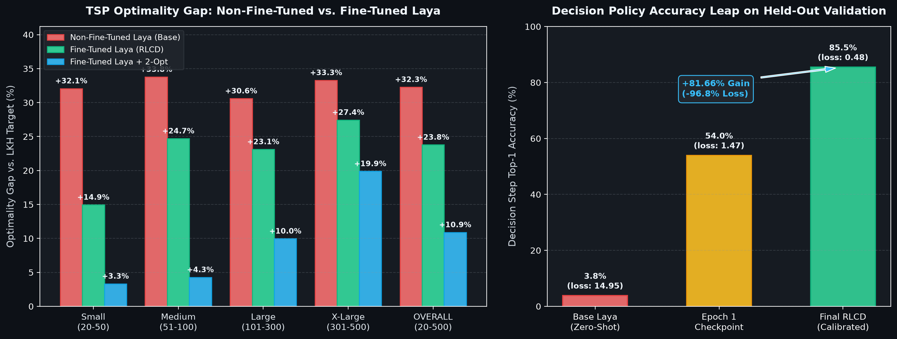

# TSP-Laya

Trying to solve **Traveling Salesperson Problem (TSP)** by fine-tuning **Laya** (a System-1 Decision Model).

## 📊 Benchmark Results (50 Held-Out Instances)

Evaluated across 50 held-out test graphs (20 to 500 cities) from `data/tsp_dataset_1000.json`.

### 1. Raw Benchmark (Construction)

| Problem Scale | City Range | Mean LKH | Mean Raw Laya | Raw Laya Gap | Mean Raw NN | Raw NN Gap | Laya Raw Win Rate |
| :--- | :---: | :---: | :---: | :---: | :---: | :---: | :---: |
| **Small** | 20 – 50 | 4.936 | **5.689** | **+14.94%** | 5.783 | +17.06% | 50.0% (3/6) |
| **Medium** | 51 – 100 | 6.927 | **8.657** | **+24.70%** | 8.755 | +26.44% | **63.6%** (7/11) |
| **Large** | 101 – 300 | 10.684 | **13.154** | **+23.11%** | 13.279 | +24.43% | 50.0% (9/18) |
| **X-Large** | 301 – 500 | 14.775 | **18.831** | **+27.43%** | 18.999 | +28.46% | 46.7% (7/15) |
| **OVERALL** | **20 – 500** | **10.395** | **12.972** | **+23.78%** | **13.100** | **+25.19%** | **52.0%** (26/50) |

### 2. 2-Opt Benchmark (Because both methods look bad without it :P)

| Problem Scale | City Range | Mean LKH  | Mean Laya + 2-Opt | Laya + 2-Opt Gap | Mean NN + 2-Opt | NN + 2-Opt Gap | Laya + 2-Opt Win Rate |
| :--- | :---: | :---: | :---: | :---: | :---: | :---: | :---: |
| **Small** | 20 – 50 | 4.936 | **5.096** | **+3.31%** | 5.132 | +4.03% | 50.0% (3/6) |
| **Medium** | 51 – 100 | 6.927 | **7.227** | **+4.27%** | 7.257 | +4.68% | **54.5%** (6/11) |
| **Large** | 101 – 300 | 10.684 | **11.763** | **+9.95%** | 11.875 | +10.85% | **61.1%** (11/18) |
| **X-Large** | 301 – 500 | 14.775 | **17.727** | **+19.88%** | 17.836 | +20.51% | **53.3%** (8/15) |
| **OVERALL** | **20 – 500** | **10.395** | **11.754** | **+10.88%** | **11.838** | **+11.57%** | **56.0%** (28/50) |

Full metrics stored in [`benchmark_results_batch50.json`](benchmark_results_batch50.json).

--- 

### 📈 Non-Fine-Tuned vs. Fine-Tuned Laya

---

## 🧠 Model Architecture & Inductive Features

* **Base Model**: ModernBERT-large backbone (`convaiinnovations/laya`) fine-tuned via RLCD (Reinforcement Learning from Calibrated Decisions).
* **Inference Speed**: ~35 ms per decision on Apple Silicon GPU (`mps`, `torch.float16`).
* **Candidate Horizon**: 8 candidate slots (`slot_0` to `slot_7`), capturing **99.9%** of optimal LKH decisions while eliminating distractor noise.
* **Spatial Inductive Features**:
  * `rank`: Nearest-neighbor rank ($1$ to $8$) among remaining unvisited cities.
  * `ndist`: Scale-invariant normalized distance ($d / \bar{d}_{\text{candidates}}$).
  * `cos`: Incoming travel direction cosine similarity $[-1.0, 1.0]$ for path momentum.
  * `dist`: Euclidean step distance.
  * `ctr`: Distance to unvisited cluster centroid (prevents premature cluster abandonment).
  * `lookahead`: 2-step lookahead distance to candidate's nearest neighbor (avoids dead-ends).
  * `depot`: Distance back to origin depot (closure penalty awareness).

---

## Some things (It's just an experiment...)

1. The difference between Non-finetuned Laya and Finetuned Laya is significant. But it's the difference init per decision/choice, so for entire problem/tour it's even more significant.
2. I wanted the model to learn 2-Opt, but it failed miserably. I'll have to finetune it again, but this time with 2-Opt in the dataset.
3. Compared to GNNs, whose performance is at 1-2% gap to LKH, it's not even close. But for a non-spatial model that was never intended for this task, it's pretty decent. (Also I was lazy to train GNNs for this benchmark, so i just gave a general statement from papers :P)
4. The runtime and memory difference w.r.t Greedy NN is huge.